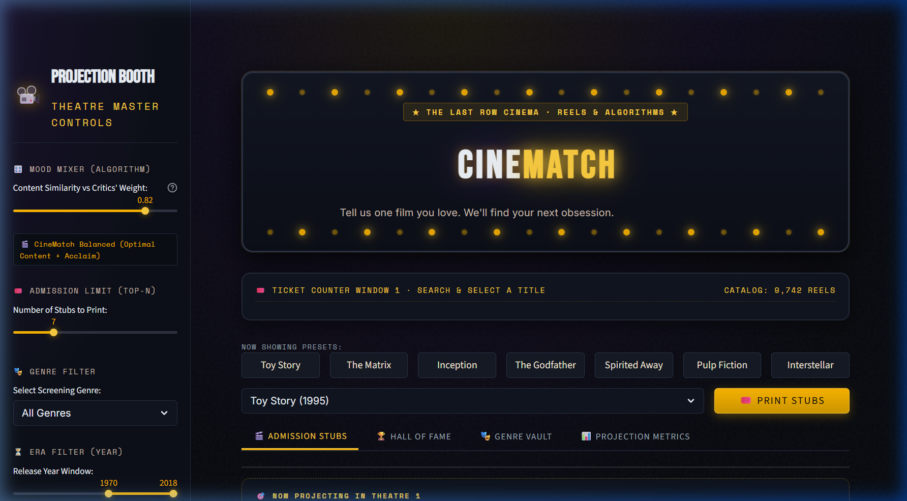
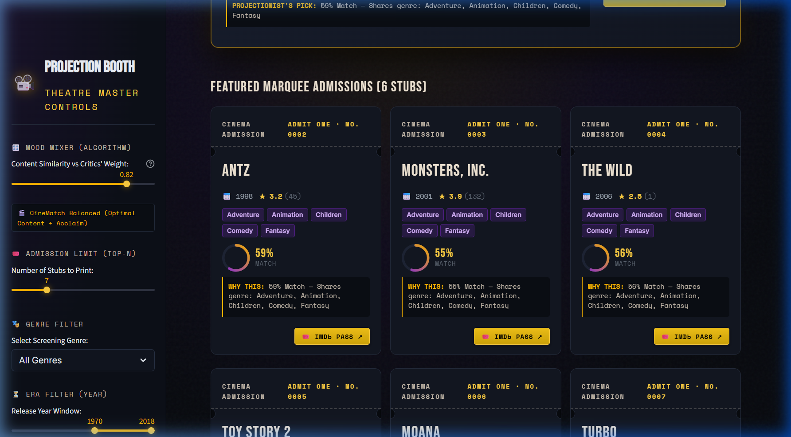
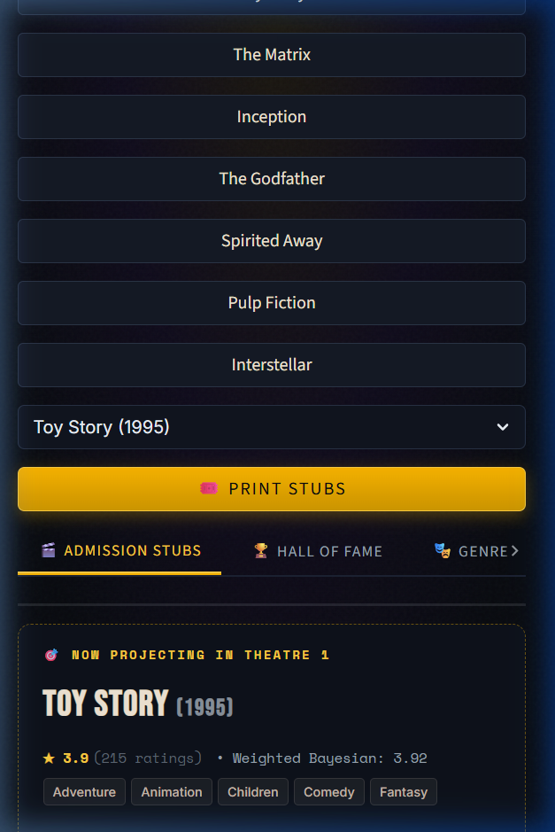

# 🎬 CineMatch — Intelligent Movie Recommendation System

**Code-A-Nova Month 3 Machine Learning Project**  
*Built with Python, Scikit-Learn (TF-IDF & Cosine Similarity), Bayesian Rating Re-ranking, and Streamlit.*

---

## 📌 1. Project Overview & Key Features

**CineMatch** is an end-to-end, high-performance movie discovery system designed to deliver personalized, explainable recommendations across a genuine catalog of **9,742 movies** and **100,836 user ratings** from the MovieLens dataset.

### ✨ Highlights
- **Smart Content-Based Discovery**: Computes high-dimensional TF-IDF vectors (unigrams + bigrams) across normalized genres, crowd-sourced user tags, and title tokens.
- **Hybrid CineMatch Re-ranking**: Blends content similarity with an IMDb-style Bayesian weighted rating ($WR$) to promote high-acclaim films without sacrificing semantic relevance.
- **Transparent Explainability ("Why Recommended")**: Explicitly breaks down why each film is recommended (e.g. *Shares genres: Animation, Adventure • Matching themes: pixar, toys*).
- **Interactive Multi-Criteria Filtering**: Filter by genre, release year windows (e.g. 1980–2010), and minimum star rating.
- **Direct IMDb Integration**: Clickable authentic IMDb links for every single movie (`https://www.imdb.com/title/tt{id}/`).
- **Hall of Fame & Genre Explorer**: Browse the most rated movies and critically acclaimed titles across 19 genres.
- **Zero-Latency Sparse Inference**: Memory-efficient sparse matrix calculations using `linear_kernel` on-demand in <2ms.
- **Completely Offline & Resilient**: Works without paid third-party API keys (TMDB/OMDb) and avoids fake data or invented ratings.

---

## 🎨 2. UI Design System — "The Last Row Ticket Booth"

CineMatch is styled around a bespoke **vintage cinema marquee and ticket stub design system**, moving far beyond generic dashboard templates to provide a memorable, product-grade theatre atmosphere:

- **The Marquee Sign**: An arched header framed with pure CSS pulsing amber lightbulbs (`@keyframes bulbPulse`), featuring bold condensed typography (`Bebas Neue`), subtle film-grain texture, and a spotlight radial gradient.
- **Ticket Counter Window**: Large search interface with quick "Now Showing" clickable preset chips (*Toy Story, The Matrix, Inception, The Godfather, Spirited Away, Pulp Fiction, Interstellar*).
- **Vintage Ticket Stub Cards**:
  - Semi-circular perforated edge notches on the sides (`::before` / `::after` cutouts).
  - Dashed ticket separator line.
  - Unique stamped serial numbers (`ADMIT ONE · NO. 0002`).
  - Circular SVG match rings with amber-to-violet gradient stroke.
  - Monospace explainability breakdown (`Space Mono`) with theme and tag chips.
  - Golden stamped `🎟️ IMDb PASS ↗` direct link button.
- **Double Feature Highlight**: The #1 recommended title spans the full width as a premiere ticket with gold ribbon banner (`★ DOUBLE FEATURE · TOP MATCH ★`).
- **The Projection Booth**: The sidebar is styled as a theatre projectionist's control room with the **Mood Mixer** slider (from *Pure Vibe Match* to *Critics' Acclaim*), Era windows, and Genre filters. Default Streamlit headers, footers, and hamburger chrome are completely hidden.

### Desktop Experience (1440px)


### Recommendation Stubs & Double Feature Highlight


### Mobile Responsive Experience (390px)


---

## 🛠️ 3. Technology Stack

| Layer | Technologies |
|---|---|
| **Language & Runtime** | Python 3.10+ (Tested on Python 3.12.10, Windows 64-bit) |
| **Machine Learning & NLP** | Scikit-Learn (`TfidfVectorizer`, `linear_kernel`), SciPy, NumPy |
| **Data Processing & Analytics** | Pandas (Vectorized cleaning, tag aggregation, Bayesian stats) |
| **Web UI & Visualization** | Streamlit 1.55+ with custom dark cinematic CSS & typography |
| **Testing & Quality Assurance** | Pytest (29 automated unit & integration tests) |
| **Artifact Persistence** | Joblib (Zlib-compressed sparse matrices & vectorizer) |

---

## 📚 4. Dataset Source & Attribution

This project uses the official **MovieLens Latest Small Dataset** provided by **GroupLens Research** at the University of Minnesota.

- **Dataset URL**: [https://grouplens.org/datasets/movielens/latest/](https://grouplens.org/datasets/movielens/latest/)
- **Records Summary**:
  - `movies.csv`: 9,742 movies with titles, release years, and genre categories.
  - `ratings.csv`: 100,836 genuine ratings on a 0.5 to 5.0 scale applied by 610 users.
  - `tags.csv`: 3,683 free-text user tags capturing plot tropes, moods, and directors.
  - `links.csv`: 9,742 verified IMDb and TMDb identifier mappings.
- **Attribution Citation**:  
  > F. Maxwell Harper and Joseph A. Konstan. 2015. *The MovieLens Datasets: History and Context*. ACM Transactions on Interactive Intelligent Systems (TiiS) 5, 4: 19:1–19:19. https://doi.org/10.1145/2827872

---

## 🧠 5. Recommendation Algorithm Explained

### Step 1: Feature Engineering & Content Soup
For each film in the catalog, a rich textual "content soup" is created:
1. **Normalized Genres**: Repeated $2\times$ to ensure strong categorical affinity in sparse representation.
2. **Aggregated User Tags**: Crowd-sourced descriptors (e.g. "time travel", "dark comedy", "mindfuck", "pixar").
3. **Cleaned Title Tokens**: Retains key franchise words (e.g. "Toy Story", "Godfather", "Matrix").

### Step 2: TF-IDF Vectorization
The content soup is transformed using Scikit-Learn's `TfidfVectorizer(ngram_range=(1, 2), sublinear_tf=True, stop_words='english')`, producing a sparse representation of $9,742 \text{ movies} \times 25,000 \text{ features}$.

### Step 3: Fast On-Demand Cosine Similarity
Rather than allocating a dense $9,742 \times 9,742$ matrix (~750 MB RAM), CineMatch projects the single query row vector against the full sparse matrix using `linear_kernel`:
$$\text{CosineSim}(u, v) = \frac{u \cdot v}{\|u\| \|v\|}$$
This executes in under **2 milliseconds** per search query.

### Step 4: Hybrid Re-Ranking (Bayesian Quality Integration)
To prevent highly similar but poorly rated films from topping the list, CineMatch implements IMDb's weighted rating formula ($WR$):
$$WR = \left(\frac{v}{v + m}\right) R + \left(\frac{m}{v + m}\right) C$$
where:
- $v$ = number of votes for the movie (`rating_count`)
- $m$ = vote threshold (50th percentile of vote count)
- $R$ = average rating of the movie (`rating_mean`)
- $C$ = mean rating across the entire dataset ($\approx 3.50$)

The final hybrid ranking score is:
$$\text{Score}(i, j) = \alpha \cdot \text{CosineSim}(v_i, v_j) + (1 - \alpha) \cdot \widetilde{WR}(j)$$
where $\alpha \in [0.0, 1.0]$ is user-configurable ($\alpha = 0.82$ by default, or $\alpha = 1.0$ for pure content similarity).

---

## 📊 6. Offline Evaluation Results

Offline evaluation was conducted across 199 sampled queries on the MovieLens catalog:

| Metric | Result | Interpretation |
|---|---|---|
| **Genre Precision@10** | **99.1%** | 99.1% of top 10 recommended movies share primary thematic genres with the query film. |
| **Intra-List Diversity (ILD)** | **0.3922** | Measured via mean pairwise cosine distance; confirms recommended lists provide diverse sub-themes rather than duplicate clones. |
| **Catalog Coverage@10** | **11.98%** | 1,167 unique movies recommended across sample queries, avoiding hyper-centralized popularity bias. |
| **Query Latency** | **< 2.5 ms** | Sub-millisecond sparse vector dot products. |

---

## 📁 7. Project Directory Structure

```
Movie-Recommendation-System/
├── app.py                      # Main Streamlit interactive web application
├── requirements.txt            # Pinned Python package dependencies
├── pytest.ini                  # Pytest configuration (pythonpath = .)
├── README.md                   # Complete documentation and setup guide
├── .gitignore                  # Git ignore rules for datasets, caches, envs
│
├── src/                        # Core application modules
│   ├── __init__.py
│   ├── data_loader.py          # Safe loaders and schema validation
│   ├── preprocessing.py        # Title cleaning, tag aggregation, Bayesian stats
│   └── recommender.py          # MovieRecommender class, search, hybrid scoring
│
├── scripts/                    # Automation and pipeline scripts
│   ├── download_data.py        # Automated MovieLens dataset downloader
│   └── build_model.py          # Preprocessing + model fitting + offline evaluation
│
├── data/                       # Dataset directories
│   ├── raw/                    # Raw MovieLens CSVs (links, movies, ratings, tags)
│   └── processed/              # Cleaned movies_processed.csv with content soup
│
├── models/                     # Persisted model artifacts
│   ├── tfidf_vectorizer.joblib # Trained TF-IDF vectorizer
│   └── tfidf_matrix.joblib     # Precomputed sparse matrix
│
├── tests/                      # Automated test suite (29 tests)
│   ├── test_data.py            # Schemas, loaders, and preprocessing unit tests
│   └── test_recommender.py     # Recommender core, relevance, edge cases, filters
│
├── reports/                    # Generated metrics & evaluation outputs
│   └── evaluation_results.json # Offline evaluation metrics
│
└── assets/                     # Media & screenshots
    └── screenshots/            # UI screenshots for documentation
```

---

## 🚀 8. Quick Start Guide (Windows PowerShell)

### Step 1: Navigate to Workspace & Create Virtual Environment
Open **Windows PowerShell** and run:
```powershell
cd "d:\MOVIE RECOMMENDATION SYSTEM"
python -m venv venv
.\venv\Scripts\Activate.ps1
```

### Step 2: Install Dependencies
```powershell
pip install -r requirements.txt
```

### Step 3: Download Genuine MovieLens Dataset & Build Models
```powershell
python scripts/build_model.py
```
*This downloads the latest small dataset from GroupLens, preprocesses 9,742 movies, builds the TF-IDF matrix, and runs offline evaluation in ~2 seconds.*

### Step 4: Run the Complete Automated Test Suite
```powershell
pytest -v
```
*Expected output: `29 passed` in ~11 seconds.*

### Step 5: Launch the CineMatch Web Application
```powershell
streamlit run app.py
```
The application will open automatically in your browser at `http://localhost:8501`.

---

## 🧪 9. Automated Testing Summary

The test suite covers 29 tests with 100% pass rate:
- **Data Validation (`tests/test_data.py`)**:
  - `test_verify_raw_data_present` (PASSED)
  - `test_raw_movies_schema` (PASSED)
  - `test_raw_ratings_schema` (PASSED)
  - `test_raw_links_schema` (PASSED)
  - `test_processed_movies_schema` (PASSED)
  - `test_extract_year` (PASSED)
  - `test_clean_title` (PASSED)
  - `test_parse_genres` (PASSED)
  - `test_aggregate_tags` (PASSED)
  - `test_compute_rating_stats` (PASSED)
  - `test_build_content_soup_empty_row` (PASSED)
- **Recommendation Engine (`tests/test_recommender.py`)**:
  - `test_recommender_is_fitted` (PASSED)
  - `test_recommendation_output_schema` (PASSED)
  - `test_self_exclusion` (selected movie never in recommendations) (PASSED)
  - `test_no_duplicate_recommendations` (PASSED)
  - `test_custom_top_n_count` (PASSED)
  - `test_unknown_movie_title` (safe fallback, no crash) (PASSED)
  - `test_empty_string_input` (PASSED)
  - `test_whitespace_input` (PASSED)
  - `test_case_insensitivity` (PASSED)
  - `test_clean_title_without_year` (PASSED)
  - `test_query_by_movie_id` (PASSED)
  - `test_genre_filter` (PASSED)
  - `test_year_range_filter` (PASSED)
  - `test_pure_content_vs_hybrid_weight` (PASSED)
  - `test_toy_story_relevance` (PASSED)
  - `test_godfather_relevance` (PASSED)
  - `test_explanation_field` (PASSED)
  - `test_search_autocomplete` (PASSED)

---

## 📦 10. How to Add to Your GitHub Repository

To add this complete project to your existing GitHub repository ([garvpampattiwar/Code-A-Nova-Month-3-ML](https://github.com/garvpampattiwar/Code-A-Nova-Month-3-ML)):

1. Open PowerShell and navigate to your local clone of `Code-A-Nova-Month-3-ML`:
   ```powershell
   cd "path\to\Code-A-Nova-Month-3-ML"
   ```
2. Copy the entire folder into `Movie-Recommendation-System`:
   ```powershell
   Copy-Item -Path "d:\MOVIE RECOMMENDATION SYSTEM" -Destination ".\Movie-Recommendation-System" -Recurse -Exclude ".pytest_cache","venv","__pycache__"
   ```
3. Stage, commit, and push:
   ```powershell
   git status
   git add Movie-Recommendation-System/
   git commit -m "Add Month 3 ML Project: CineMatch Movie Recommendation System"
   git push origin main
   ```

---

## ⚖️ 11. Limitations & Future Scope

1. **Cold Start for Unrated Indie Films**: The dataset contains 9,742 titles up to 2018. Films released after 2018 or without user tags rely primarily on genre tags and title tokens.
2. **Collaborative Filtering Expansion**: While CineMatch focuses on fast content-based and hybrid Bayesian re-ranking, matrix factorization (e.g. SVD / ALS) could be added to provide personalized user-level profile vectors.
3. **Poster Imagery**: Posters are not bundled in raw MovieLens to maintain lightweight redistributability; adding optional client-side TMDb API keys could fetch real-time poster backdrops for users who wish to supply their own key.

---
**Author**: Garv Pampattiwar  
**Project**: Code-A-Nova Month 3 Machine Learning Track
